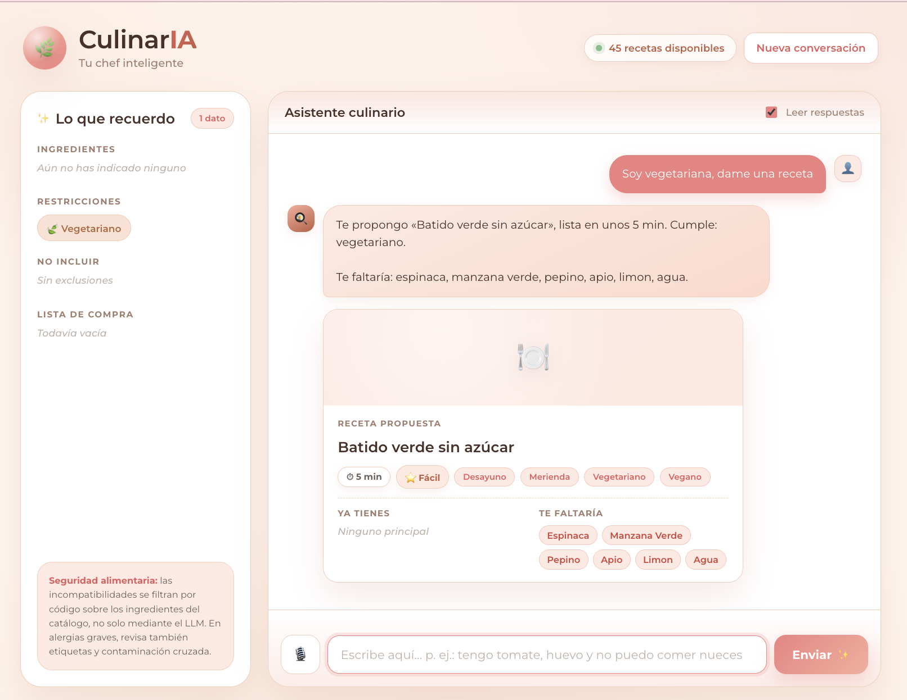
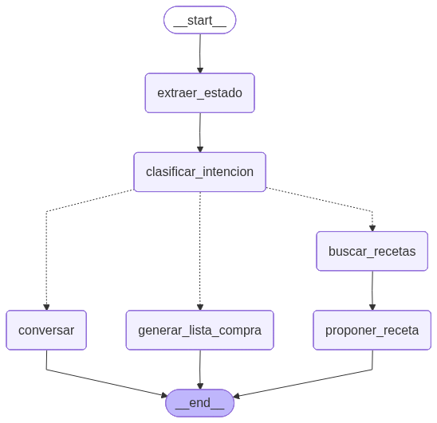
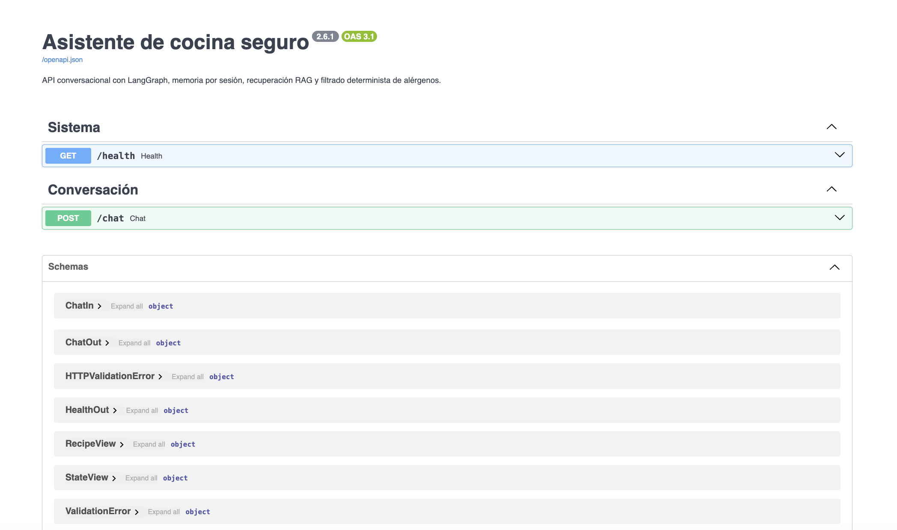

# CulinarIA · LLM Recipe Assistant

**Conversational cooking assistant with LangGraph, RAG, conversational memory and deterministic allergen safety — served through a FastAPI backend and a web UI with voice.**
Master's in Artificial Intelligence · UDIT · Natural Language Processing and Generation · Final project · 2026

**Authors:** María Fernanda Martínez García · María Tocado Murillo

> 🇪🇸 **Resumen:** asistente conversacional de cocina que recuerda tus ingredientes y restricciones, recupera recetas con RAG y propone platos seguros. El LLM interpreta la conversación, pero las alergias y exclusiones se filtran por código. API FastAPI e interfaz web con entrada y lectura por voz. Trabajo en equipo.

---

  

## What it does

Tell it what you have in the fridge and what you can't eat — *"I have tomato and eggs, and I can't eat nuts"* — and it:

- **remembers** your ingredients, dietary restrictions, allergies and exclusions across the conversation;
- **retrieves** matching recipes from a 45-recipe catalogue with RAG;
- **proposes** a safe recipe, showing what you already have and what's missing;
- **builds a shopping list**;
- handles corrections like *"I want something for lunch, not breakfast"* or *"actually, I have nuts"* after declaring a nut allergy.

## Architecture

  

| Layer | Implementation |
|---|---|
| **Agent graph** | LangGraph `StateGraph` with 6 nodes: state extraction → **LLM-inferred intent routing** → recipe search → recipe proposal / shopping list / conversation |
| **Memory** | Per-conversation state (`thread_id` + `MemorySaver` checkpointer) holding ingredients, restrictions, allergens and shopping list |
| **RAG** | Local multilingual embeddings (`paraphrase-multilingual-MiniLM-L12-v2`) + **Chroma**, with a lexical fallback if embeddings are unavailable |
| **Safety layer** | **Deterministic** allergen, diet and exclusion filtering in code — the LLM extracts intent but never has the last word on safety; every recipe is re-validated right before being shown |
| **LLM** | Llama 3.3 70B via Groq (provider-agnostic config, OpenAI supported) · temperature 0 |
| **API** | FastAPI: `/chat`, `/health`, OpenAPI docs at `/docs` |
| **Web UI** | Responsive interface with memory panel, recipe cards, quick actions, **voice input (speech recognition) and spoken responses (speech synthesis)** |
| **Quality** | pytest suite covering safety rules, catalogue, conversation flow and API endpoints · spec-driven development (OpenSpec: proposal, design, specs, tasks) |

## Why the safety layer matters

LLMs are good at understanding *"no puedo comer nueces"* but not reliable enough to guarantee an allergen never slips through. Before any recipe is shown, code checks that:

1. its tags satisfy the dietary restrictions (e.g. vegan ≠ vegetarian);
2. no ingredient belongs to an active allergen family (normalising plurals such as *nueces → nuez*);
3. no user-excluded ingredient appears;
4. the recipe passes validation again right before rendering;
5. an incompatible ingredient later declared as available is **not** added to the pantry and triggers an explicit warning.

## Test scenarios covered

Vegetarian and vegan requests · gluten-free · sugar-free · allergies · progressive context building · changing a recipe · missing ingredients · shopping list generation · API endpoints.

  

## Tech stack

Python · LangGraph · LangChain · Chroma · Hugging Face embeddings · Groq API (Llama 3.3 70B) · FastAPI · Uvicorn · HTML/CSS/JS · Web Speech API · pytest

## About this repository

This is a **showcase** of a team project. Source code, recipe catalogue and project report are not published.

---

**María Tocado Murillo** · Applied AI & Data Scientist · [LinkedIn](https://www.linkedin.com/in/mar%C3%ADa-tocado-murillo/) · [GitHub](https://github.com/Maria-TM1)

© 2026 María Fernanda Martínez García and María Tocado Murillo. All rights reserved — see [LICENSE](LICENSE).
